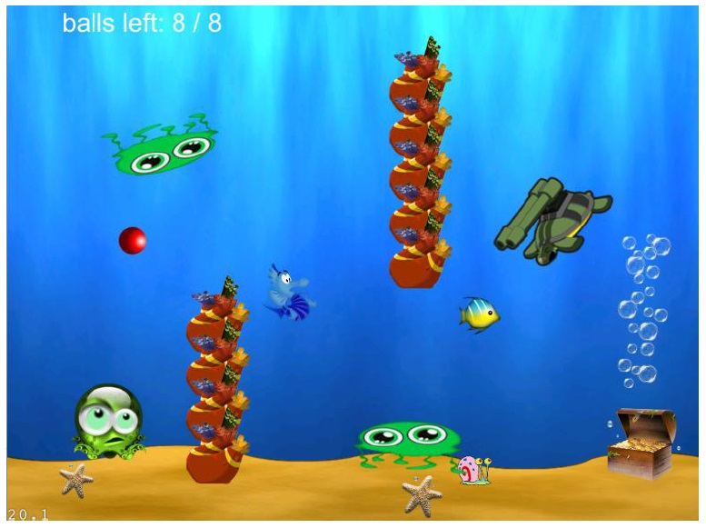

# Smartphone Game

<p align="center">
  
</p>

*Original project image, unchanged.*

The students built a touch-controlled physics game for the iPad using Cocos2D and Box2D. Players launch balls, adjust trampolines and try to reach targets.

Students: Liav Sitruk, Idan Banani. Supervision: Aaron Wetzler.


## Original

The 16-page Spring 2012 report and the original image are preserved. Idan Banani supplied [the source repository](https://github.com/IdanBanani/iOS-4-2D-game-for-iPad); [the inspected revision](https://github.com/IdanBanani/iOS-4-2D-game-for-iPad/tree/270b45ce6a1e149209e1d595e492766ede3b7747) has no Xcode project, and no current build has been recorded. The [recovery notes](docs/RECOVERY.md) record historical requirements and attribution; see also [PROVENANCE.md](PROVENANCE.md).

## Updated

[**Run the browser demo**](https://twerdster.github.io/smartphone-game/)

A separate browser game, written in November 2026, offers one new cannon-and-trampoline level. Set the cannon angle and launch speed, tilt the trampoline, drag it into position and try to hit the target. It uses new vector artwork and simplified physics, and is not a port of the students' code, assets or levels. The recovered original files are unchanged.

### Run locally

```sh
python3 -m http.server 8000 --directory docs
```

Then open http://localhost:8000. No build step or external service is required.

### Checks and licensing

Browser-check results, implementation notes and limits are in [updated/README.md](updated/README.md). These checks apply only to the new game; they do not validate the historical application or any device. The [MIT license](docs/DEMO-LICENSE.txt) covers only the new game; original materials keep their existing attribution and terms.
